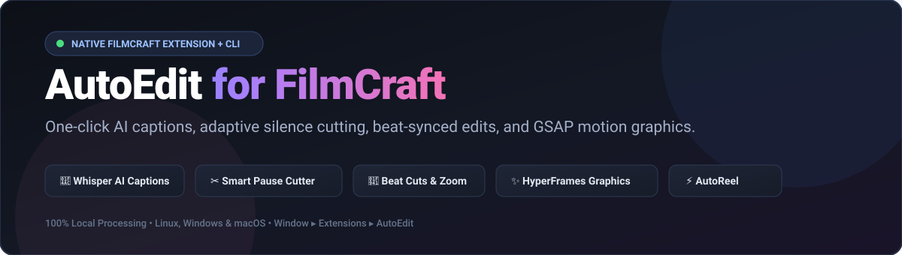
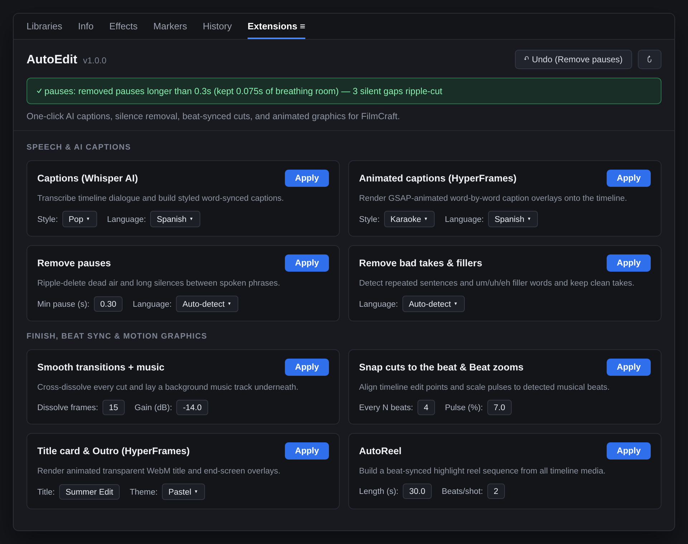
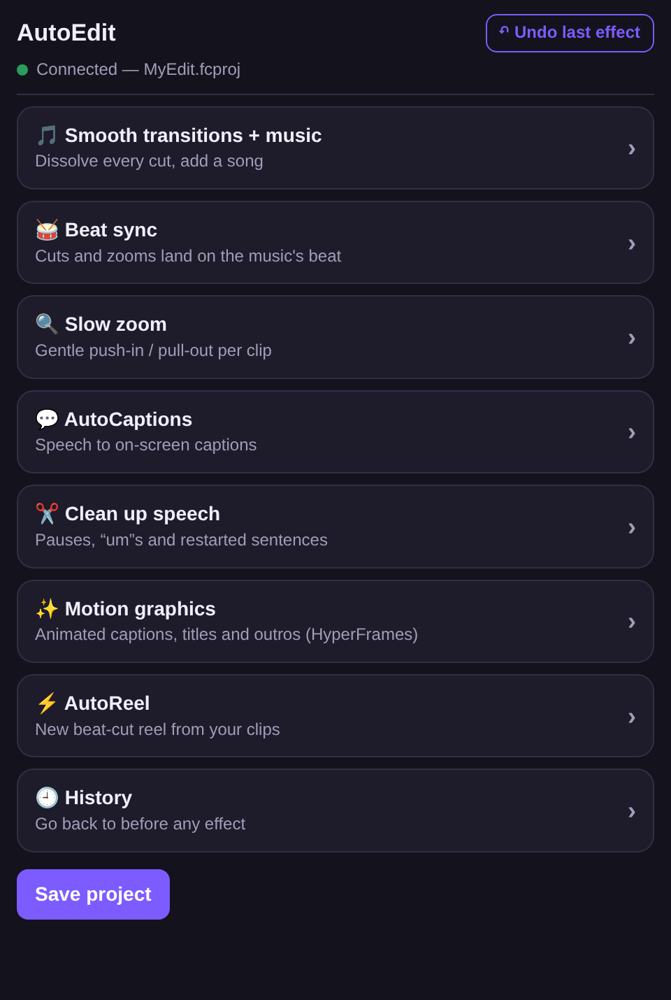
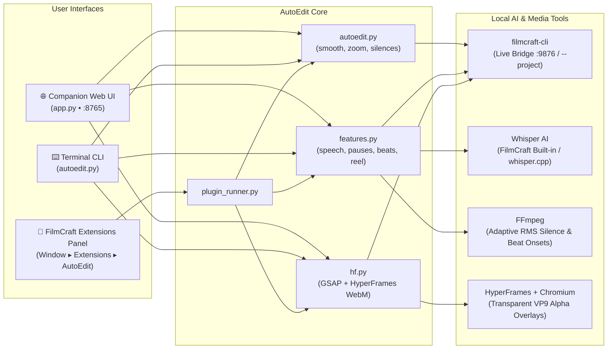

<div align="center">



<br />

[](https://github.com/justdxvid/autoedit/actions/workflows/ci.yml)


**One-click AI captions, adaptive silence cutting, beat-synced edits, and GSAP motion graphics for [FilmCraft](https://github.com/storytold/filmcraft).**  
Runs 100% locally on **Linux**, **Windows**, and **macOS** — no cloud subscriptions or API keys required.

[Features](#-all-13-one-click-actions) •
[Native Extension](#-native-filmcraft-extension-panel) •
[Installation](#-installation) •
[How to Use](#-how-to-use) •
[CLI Reference](#️-command-line-reference) •
[Guía en Español](#-guía-en-español)

</div>

---

## ✨ Overview

**AutoEdit** supercharges [FilmCraft](https://github.com/storytold/filmcraft) with 13 automated editing tools powered by local AI speech recognition ([whisper.cpp](https://github.com/ggml-org/whisper.cpp) / FilmCraft's built-in Whisper engine), adaptive RMS acoustic silence analysis (`ffmpeg`), onset-envelope tempo tracking, and transparent WebM motion graphics ([HyperFrames](https://github.com/heygen-com/hyperframes) + GSAP).

You can use AutoEdit in **three ways**:
1. **🧩 Native Dockable Extension inside FilmCraft** (`Window ▸ Extensions ▸ AutoEdit`)
2. **🌐 Standalone Companion Web Panel** (`http://127.0.0.1:8765` or macOS menu bar app)
3. **⌨️ Headless Command-Line Interface** (`python3 autoedit.py ...` against a live session or `.fcproj` file)

---

## 🧩 Native FilmCraft Extension Panel

AutoEdit integrates directly into FilmCraft's dockable workspace as a native extension panel, complete with parameter controls, category grouping, status notifications, and one-click undo.

<div align="center">
  
</div>

---

## 🚀 All 13 One-Click Actions

### 🎬 Finish
| Action | ID | What It Does | Parameters |
|---|---|---|---|
| **Smooth transitions + music** | `smooth` | Adds a `cross_dissolve` transition to every cut on the main video track and optionally lays a background song on a dedicated audio track at your chosen gain. | `frames` (`15`), `music` (file), `db` (`-14.0`), `mute` (`false`) |
| **Slow zoom** | `zoom` | Animates subtle alternating push-in / pull-out scale keyframes across every clip on the timeline. | `amount` (`8.0%`) |

### 🥁 Beat Sync
| Action | ID | What It Does | Parameters |
|---|---|---|---|
| **Snap cuts to the beat** | `beatcuts` | Detects the musical BPM & beat grid and ripple-trims each video edit point onto the nearest beat while preserving transitions and still images. | *(Automatic)* |
| **Beat zooms** | `beatzoom` | Adds energetic scale punch-in keyframes on every *N*th musical beat and eases back out over 8 frames. | `every` (`4` beats), `amount` (`7.0%`) |
| **Beat markers** | `beatmarkers` | Drops color-coded program markers (`Rose` on downbeats, `Mango` on subdivisions) along the sequence timeline. | `every` (`1` beat) |

### 💬 Speech & AI Captions
| Action | ID | What It Does | Parameters |
|---|---|---|---|
| **Captions (Whisper AI)** | `captions` | Transcribes timeline speech locally and creates a styled, word-synced caption track (supports Latin, Devanagari, Gurmukhi, and Nastaliq scripts). | `style` (`pop`, `pastel`, `clean`), `language` (`auto`, `en`, `es`, `fr`, `de`, `pt`, `it`, `ja`) |
| **Animated captions (HyperFrames)** | `animcaptions` | Renders GSAP-animated word-by-word caption overlays to transparent VP9 WebM and places them on an `Animated captions` overlay track. | `style` (`karaoke`, `pastel`, `bounce`), `language` (`auto`, `en`, `es`) |
| **Remove pauses** | `pauses` | Combines Whisper word timestamps with **adaptive 20 ms RMS acoustic silence detection** to tighten word boundaries and ripple-delete dead air while keeping natural breathing room and protecting still-image tracks. | `min` (`0.3s`), `language` (`auto`, `en`, `es`) |
| **Remove um/uh fillers** | `fillers` | Detects and ripple-cuts hesitation/filler words in English and Spanish (`um`, `uh`, `er`, `ah`, `eh`, `em`, `hmm`, etc.). | `language` (`auto`, `en`, `es`) |
| **Remove bad takes** | `badtakes` | Detects repeated/restarted sentences (`>= 3` matching words within a 15-word window) and ripple-cuts the earlier failed take, keeping only the final clean delivery. | `language` (`auto`, `en`, `es`) |

### 🎨 Motion Graphics (HyperFrames)
| Action | ID | What It Does | Parameters |
|---|---|---|---|
| **Title card** | `title` | Renders an animated lower-third / full title card (`GSAP` + transparent `WebM`) and places it at the start of the timeline on the `Titles` track. | `title` (`"Summer Edit"`), `subtitle`, `theme` (`pastel`, `bold`, `clean`), `position` (`top`, `middle`, `bottom`), `seconds` (`3.0s`) |
| **Outro card** | `outro` | Renders an animated end-screen overlay and places it over the final seconds of the sequence. | `title` (`"Follow for more"`), `subtitle`, `theme` (`pastel`, `bold`, `clean`), `position` (`top`, `middle`, `bottom`), `seconds` (`3.0s`) |

### ⚡ Build
| Action | ID | What It Does | Parameters |
|---|---|---|---|
| **AutoReel** | `reel` | Analyses a song's tempo and builds a brand-new beat-synced highlight sequence (`AutoReel`) cutting through your timeline media every *N* beats. | `music` (file), `length` (`30.0s`), `bps` (`2` beats/shot) |

---

## 📦 Installation

### 🐧 Linux
1. **Install system dependencies**:
   ```bash
   # Arch / Omarchy Linux
   sudo pacman -S python ffmpeg nodejs npm

   # Ubuntu / Debian
   sudo apt update && sudo apt install -y python3 ffmpeg nodejs npm
   ```
2. **Clone and run the installer**:
   ```bash
   git clone https://github.com/justdxvid/autoedit.git
   cd autoedit
   ./install.sh
   ```
   **What `./install.sh` sets up automatically:**
   - Installs local HyperFrames (`hyperframes` + `gsap`) inside `hyperframes/node_modules`.
   - Registers the native FilmCraft plugin in `~/.local/share/filmcraft/plugins/autoedit/`.
   - Installs the `autoedit` CLI launcher in `~/.local/bin/autoedit`.
   - Creates a desktop entry (`~/.local/share/applications/autoedit.desktop`).

---

### 🪟 Windows
1. **Install dependencies**:
   ```powershell
   winget install Python.Python.3.12
   winget install Gyan.FFmpeg
   winget install OpenJS.NodeJS
   ```
2. **Run the installer**:
   - Double-click **`Install AutoEdit.bat`**, or run in PowerShell:
     ```powershell
     powershell -ExecutionPolicy Bypass -File .\install.ps1
     ```
   - This installs HyperFrames, creates `autoedit.cmd`, adds a Start Menu shortcut, and installs the native FilmCraft plugin into `%APPDATA%\FilmCraft\plugins\autoedit`.

---

### 🍎 macOS
1. Ensure [Homebrew](https://brew.sh) and FilmCraft are installed.
2. Double-click **`Install AutoEdit.command`** or run:
   ```bash
   ./install.sh
   ```
   - Installs `ffmpeg`, `whisper-cpp`, `node`, and `hyperframes`.
   - Builds the macOS menu bar companion app (`~/Applications/AutoEdit.app`).
   - Registers the native FilmCraft plugin in `~/Library/Application Support/FilmCraft/plugins/autoedit`.

---

## 🎮 How to Use

<table width="100%">
<tr>
<td width="55%" valign="top">

### Method 1: Inside FilmCraft (Recommended)
1. Install or update the plugin at any time with:
   ```bash
   python3 autoedit.py install-plugin
   ```
2. Open **FilmCraft**.
3. In the top menu bar, click **Window ▸ Extensions ▸ AutoEdit** (or check **Edit ▸ Preferences ▸ Plugins…**).
4. Adjust any parameter on a card (e.g. *Min pause (s)*, *Style*, *Language*, *Zoom %*) and click **Apply**.
5. Need to revert? Click **↶ Undo** at the top of the Extensions panel (or press `Ctrl+Z` / `Cmd+Z`).

### Method 2: Standalone Web Companion Panel
1. Start FilmCraft with the control bridge enabled (automatic when launched from the panel, or `FILMCRAFT_CONTROL_PORT=9876 filmcraft`).
2. Run `python3 app.py` (or double-click **`Start AutoEdit.bat`** / **`autoedit`**).
3. Your browser opens **`http://127.0.0.1:8765`** with full access to all 13 tools and a snapshot-based **History** tab.

</td>
<td width="45%" align="center" valign="top">
  
</td>
</tr>
</table>

---

## ⌨️ Command-Line Reference

Every feature can be driven directly from the terminal — either against a **live FilmCraft window** (`--bridge 127.0.0.1:9876`, the default) or **headlessly on a `.fcproj` file** (`--project path/to/project.fcproj`):

```bash
# Install or remove the native FilmCraft extension
python3 autoedit.py install-plugin
python3 autoedit.py uninstall-plugin

# Finish & motion
python3 autoedit.py smooth --frames 15 --music ~/Music/AutoEdit/song.mp3 --music-db -14
python3 autoedit.py zoom --amount 8

# Beat sync
python3 autoedit.py beatcuts
python3 autoedit.py beatzoom --every 4 --amount 7
python3 autoedit.py beatmarkers --every 1

# Speech & AI captions
python3 autoedit.py captions --style pop --language auto
python3 autoedit.py animcaptions --style karaoke --language es
python3 autoedit.py pauses --min 0.3 --language auto
python3 autoedit.py fillers --language auto
python3 autoedit.py badtakes --language auto

# Motion graphics overlays (HyperFrames + GSAP)
python3 autoedit.py title --title "Summer Edit" --subtitle "Episode 1" --theme pastel --position middle --seconds 3
python3 autoedit.py outro --title "Follow for more" --theme bold --seconds 3

# Build a beat-synced highlight reel sequence
python3 autoedit.py reel --music ~/Music/AutoEdit/song.mp3 --length 30 --beats-per-shot 2 --name "AutoReel"

# Headless mode on a saved project file (no GUI required)
python3 autoedit.py --project my_video.fcproj pauses --min 0.3
```

---

## 🏗️ Architecture



---

## 🇪🇸 Guía en Español

### ¿Qué es AutoEdit?
**AutoEdit** es un plugin nativo y conjunto de herramientas de edición automática en un clic para **FilmCraft** (compatible con Linux, Windows y macOS). Todo se procesa localmente en tu PC.

### Instalación rápida
1. **Clona el repositorio e instala el plugin**:
   ```bash
   git clone https://github.com/justdxvid/autoedit.git
   cd autoedit
   ./install.sh
   # O únicamente para registrar/actualizar el plugin dentro de FilmCraft:
   python3 autoedit.py install-plugin
   ```
2. En **Windows**, haz doble clic en **`Install AutoEdit.bat`** (o ejecuta `powershell -ExecutionPolicy Bypass -File install.ps1`).

### Cómo abrir y usar la extensión dentro de FilmCraft
1. Abre **FilmCraft**.
2. En el menú superior ve a **Window ▸ Extensions ▸ AutoEdit** (también puedes ver los plugins instalados en **Edit ▸ Preferences ▸ Plugins…**).
3. El panel **AutoEdit** aparecerá acoplado junto a tus paneles de *Effects*, *Libraries* e *Info*:
   - **Captions (Whisper AI)**: Transcribe tu voz en español, inglés o detección automática y genera subtítulos sincronizados palabra por palabra (`Pop`, `Pastel`, `Clean`).
   - **Animated captions (HyperFrames)**: Genera subtítulos animados con GSAP (`Karaoke`, `Pastel`, `Bounce`) en video transparente sobre una pista superior.
   - **Remove pauses**: Analiza el audio con detección adaptativa de silencios RMS y corta automáticamente los espacios sin sonido (por defecto pausas `>= 0.3s`), uniendo los cortes en rizo sin cortar ni desincronizar tus imágenes fijas.
   - **Remove um/uh fillers & Remove bad takes**: Elimina muletillas (`eh`, `em`, `ah`, `um`, `uh`) y frases repetidas.
   - **Smooth transitions + music / Slow zoom**: Añade disolvencias cruzadas en cada corte, música de fondo y zooms suaves alternados.
   - **Snap cuts to the beat / Beat zooms / Beat markers**: Detecta los BPM de la canción y ajusta los cortes o pulsos de zoom al ritmo de la música.
   - **Title card / Outro card**: Crea tarjetas de título y pantalla final animadas con fondo transparente.
   - **AutoReel**: Crea una nueva secuencia vertical cortada automáticamente al ritmo de la música.
4. Para deshacer cualquier acción, pulsa el botón **↶ Undo** en la esquina superior derecha del panel de AutoEdit (o `Ctrl+Z`).

---

## 🧪 Running Tests

Run the full cross-platform unit and integration test suite (`70` tests):

```bash
python3 -m unittest discover -s tests -p "test_*.py" -v
```

---

## 🗑️ Uninstall

- **Linux / macOS**: Run `./uninstall.sh` (or `python3 autoedit.py uninstall-plugin` to remove only the FilmCraft extension).
- **Windows**: Double-click **`Uninstall AutoEdit.bat`** (or run `powershell -ExecutionPolicy Bypass -File uninstall.ps1`).

Your FilmCraft projects, rendered overlays, and music files are always preserved.

---

## 📄 License

MIT License. Built for [FilmCraft](https://github.com/storytold/filmcraft) (MIT/Apache-2.0), using [HyperFrames](https://github.com/heygen-com/hyperframes) (Apache-2.0) and [whisper.cpp](https://github.com/ggml-org/whisper.cpp) (MIT).
